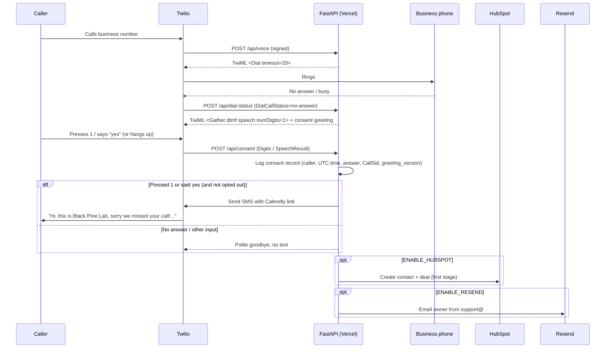

# Missed-Call Agent Demo

Every missed call is a lost lead. This small FastAPI service turns a missed call into a booked appointment: when nobody picks up, the caller is asked whether they'd like a booking link by text, and only callers who press 1 or say yes get one. Each answer is logged as a consent record. Optionally it logs the lead in HubSpot and emails the owner via Resend.

Built by [Black Pine Lab](https://blackpinelab.com).

## How it works



- Every webhook is verified with Twilio's `X-Twilio-Signature`.
- Optional hooks can fail without breaking the call flow.
- If `FORWARD_TO_NUMBER` is blank, every call is treated as missed (handy for demos).

## SMS consent (verbal opt-in)

No text is sent automatically. After a missed call the caller hears:

> Hi, you've reached Black Pine Lab. Sorry we missed your call. Would you like us to text you a link to book a time? We will send one initial text after your consent. If you reply, additional conversational responses may follow. Opt-out, help, or re-subscription confirmations may also be sent. Message and data rates may apply. Reply HELP for help or STOP to opt out at any time. Terms are at blackpinelab.com/terms and our privacy policy is at blackpinelab.com/privacy. Press 1 or say yes to receive the text. To skip the text, simply hang up.

- Pressing 1, or speech containing the word "yes", sends one SMS (unless the number has opted out, see below) and plays:

  > Thanks. We will attempt to send your Black Pine Lab booking link if your number is eligible. If you previously opted out, you must text START or UNSTOP to this number before texts can resume. Message and data rates may apply. Goodbye.

- Any other input or no input: no text, polite goodbye.
- SMS: `Hi, this is Black Pine Lab, sorry we missed your call! You can book a time here: {CALENDLY_URL} or reply with how we can help. Reply STOP to opt out.`
- Every answer is written as a JSON consent record (`caller`, `timestamp_utc`, `answer`, `call_sid`, `consented`, `greeting_version`) to the `missed_call.consent` logger. `greeting_version` (currently `2026-10-22-artemis-final`) records which script the caller heard, so consent can be matched to the published opt-in page. Plug in a persistent store with `app.consent.set_store(fn)`.

## Inbound SMS keywords (`/api/sms`)

`POST /api/sms` is the number's incoming-message webhook (signature-verified like the voice routes). Keywords are matched case-insensitively on the whole message:

| Keyword | Effect | App reply |
|---|---|---|
| `STOP`, `STOPALL`, `UNSUBSCRIBE`, `CANCEL`, `END`, `QUIT` | Number added to the opt-out list | None (empty TwiML) |
| `START`, `UNSTOP` | Number removed from the opt-out list | None (empty TwiML) |
| `HELP` | Nothing recorded | `Black Pine Lab: missed-call follow-up texts. Email support@blackpinelab.com. Reply STOP to opt out.` |

On toll-free numbers the carrier/Twilio sends the STOP and START confirmations itself, so the app deliberately does not send its own.

**Opt-out block on consent:** `/api/consent` never texts a number on the opt-out list. Pressing 1 or saying yes on a call does **not** clear an opt-out; only texting START or UNSTOP does. The consent record is still logged.

> **Storage:** without `DATABASE_URL` the opt-out list is in memory and consent records go only to logs. That's fine for tests and local runs, but it is lost on restart and not shared across Vercel instances. Set `DATABASE_URL` (see [Durable storage](#durable-storage-postgres)) and point the Twilio incoming-message webhook at `/api/sms` before activation.

## Durable storage (Postgres)

When `DATABASE_URL` is set, `app/storage.py` stores the opt-out list (`sms_opt_outs`) and consent records (`sms_consent`) in Postgres. Any Postgres works; Supabase and Neon both have free tiers.

1. Create a Postgres database and copy its **pooled** connection string (Supabase: "Transaction pooler", port 6543; Neon: the `-pooler` host). Serverless functions open a short connection per request.
2. Run `migrations/001_init.sql` once in the provider's SQL editor (or `psql "$DATABASE_URL" -f migrations/001_init.sql`). It is safe to re-run.
3. Add `DATABASE_URL` to Vercel → Project → Settings → Environment Variables and redeploy.

Failure handling (fail closed):

- **Production requires `DATABASE_URL`.** When `VERCEL_ENV=production` or `APP_ENV=production` and `DATABASE_URL` is unset, the app logs an error at startup and disables SMS sending (no silent fallback to memory). Calls still get a polite goodbye.
- **Consent is recorded first.** `/api/consent` writes the consent record before sending anything. If the write fails, no text is sent and the caller hears: "Sorry, we couldn't send a text right now. Thanks for calling Black Pine Lab. Goodbye."
- **Opt-out lookup failures** (database down) treat the number as blocked, so no text is sent.

Preview and local environments without `DATABASE_URL` keep the in-memory/log defaults.

## Project layout

```
api/index.py          Vercel entrypoint
app/main.py           Webhooks + TwiML
app/consent.py        SMS consent records (pluggable store)
app/integrations.py   Twilio SMS, HubSpot, Resend
tests/                Unit tests (all external APIs mocked)
vercel.json           Routes /api/* to the app
```

## Run locally

```bash
python -m venv .venv && source .venv/bin/activate
pip install -r requirements-dev.txt
pytest -q
cp .env.example .env   # fill in values
uvicorn app.main:app --reload
```

Expose it with a tunnel (e.g. `ngrok http 8000`) and set `PUBLIC_BASE_URL` to the tunnel URL so signature checks match.

## Deploy to Vercel (free tier)

1. Import this repo in Vercel (framework preset: Other).
2. Add the env vars from `.env.example` under Project → Settings → Environment Variables.
3. Set `PUBLIC_BASE_URL` to your production URL, e.g. `https://missed-call-agent-demo.vercel.app`, and redeploy.
4. Check `https://<your-app>/api/health` returns `{"ok": true}`.

## Twilio setup (do this later, at activation)

In Twilio Console → Phone Numbers → Manage → Active numbers → your number, set:

| Section | Setting | Value |
|---|---|---|
| Voice configuration | A call comes in | Webhook, `https://<your-app>.vercel.app/api/voice`, HTTP POST |
| Messaging configuration | A message comes in | Webhook, `https://<your-app>.vercel.app/api/sms`, HTTP POST |

`/api/dial-status` and `/api/consent` are reached through the TwiML the app returns (`<Dial action>` and `<Gather action>`), so you don't configure them in the console. `PUBLIC_BASE_URL` must equal `https://<your-app>.vercel.app` exactly, or signature checks will fail with 403.

### Texting US numbers: toll-free vs A2P 10DLC

- **Local (10DLC) numbers** need A2P 10DLC brand + campaign registration before carriers deliver your SMS. Approval can take days.
- **Toll-free numbers** need toll-free verification, but are usually the fastest path for a demo.
- **Trial accounts** can only text verified phone numbers. Fine for testing on your own phone.

## Environment variables

| Variable | Required | Purpose |
|---|---|---|
| `TWILIO_ACCOUNT_SID`, `TWILIO_AUTH_TOKEN` | yes | Twilio API + signature validation |
| `TWILIO_PHONE_NUMBER` | yes | Number SMS is sent from (E.164) |
| `PUBLIC_BASE_URL` | yes | Public URL used for signature validation |
| `CALENDLY_URL` | yes | Booking link texted to callers |
| `BUSINESS_NAME` | no | Used in the SMS |
| `FORWARD_TO_NUMBER`, `DIAL_TIMEOUT_SECONDS` | no | Ring a real phone first |
| `ENABLE_HUBSPOT`, `HUBSPOT_TOKEN`, `HUBSPOT_PIPELINE_ID`, `HUBSPOT_PIPELINE_STAGE_ID` | no | Create contact + deal |
| `ENABLE_RESEND`, `RESEND_API_KEY`, `RESEND_FROM`, `NOTIFY_EMAIL` | no | Owner notification email |
| `DATABASE_URL` | yes in production | Postgres URL (pooled) for opt-outs + consent; unset = in-memory locally, SMS disabled in production |
| `APP_ENV` | no | Set to `production` to enforce `DATABASE_URL` outside Vercel (`VERCEL_ENV` is set by Vercel automatically) |
| `SKIP_TWILIO_VALIDATION` | no | Local dev only |

## License

MIT
