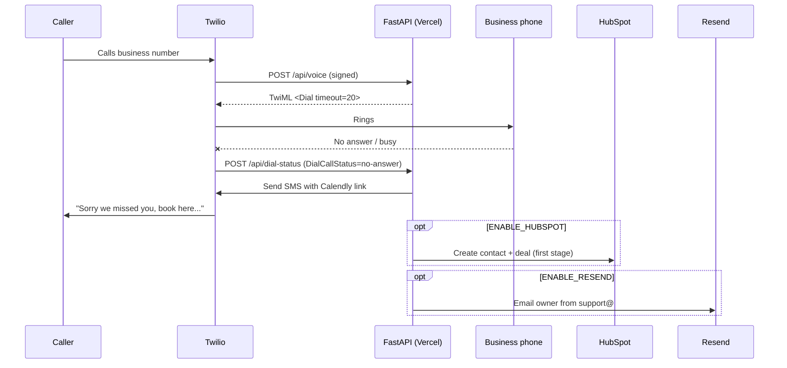

# Missed-Call Agent Demo

Every missed call is a lost lead. This small FastAPI service turns a missed call into a booked appointment: when nobody picks up, the caller gets a text with a booking link within seconds. Optionally it logs the lead in HubSpot and emails the owner via Resend.

Built by [Black Pine Lab](https://blackpinelab.com).

## How it works



- Every webhook is verified with Twilio's `X-Twilio-Signature`.
- Optional hooks can fail without breaking the call flow.
- If `FORWARD_TO_NUMBER` is blank, every call is treated as missed (handy for demos).

## Project layout

```
api/index.py          Vercel entrypoint
app/main.py           Webhooks + TwiML
app/integrations.py   Twilio SMS, HubSpot, Resend
tests/                Unit tests (all external APIs mocked)
vercel.json           Routes /api/* to the app
```

## Run locally

```bash
python -m venv .venv && source .venv/bin/activate
pip install -r requirements-dev.txt
pytest -q
cp .env.example .env   # fill in values
uvicorn app.main:app --reload
```

Expose it with a tunnel (e.g. `ngrok http 8000`) and set `PUBLIC_BASE_URL` to the tunnel URL so signature checks match.

## Deploy to Vercel (free tier)

1. Import this repo in Vercel (framework preset: Other).
2. Add the env vars from `.env.example` under Project → Settings → Environment Variables.
3. Set `PUBLIC_BASE_URL` to your production URL, e.g. `https://missed-call-agent-demo.vercel.app`, and redeploy.
4. Check `https://<your-app>/api/health` returns `{"ok": true}`.

## Configure the Twilio number

In Twilio Console → Phone Numbers → your number → Voice configuration:

| Setting | Value |
|---|---|
| A call comes in | Webhook, `https://<your-app>/api/voice`, HTTP POST |

The `/api/dial-status` callback is set automatically via the `<Dial action>` in the TwiML.

### Texting US numbers: toll-free vs A2P 10DLC

- **Local (10DLC) numbers** need A2P 10DLC brand + campaign registration before carriers deliver your SMS. Approval can take days.
- **Toll-free numbers** need toll-free verification, but are usually the fastest path for a demo.
- **Trial accounts** can only text verified phone numbers. Fine for testing on your own phone.

## Environment variables

| Variable | Required | Purpose |
|---|---|---|
| `TWILIO_ACCOUNT_SID`, `TWILIO_AUTH_TOKEN` | yes | Twilio API + signature validation |
| `TWILIO_PHONE_NUMBER` | yes | Number SMS is sent from (E.164) |
| `PUBLIC_BASE_URL` | yes | Public URL used for signature validation |
| `CALENDLY_URL` | yes | Booking link texted to callers |
| `BUSINESS_NAME` | no | Used in the SMS |
| `FORWARD_TO_NUMBER`, `DIAL_TIMEOUT_SECONDS` | no | Ring a real phone first |
| `ENABLE_HUBSPOT`, `HUBSPOT_TOKEN`, `HUBSPOT_PIPELINE_ID`, `HUBSPOT_PIPELINE_STAGE_ID` | no | Create contact + deal |
| `ENABLE_RESEND`, `RESEND_API_KEY`, `RESEND_FROM`, `NOTIFY_EMAIL` | no | Owner notification email |
| `SKIP_TWILIO_VALIDATION` | no | Local dev only |

## License

MIT
